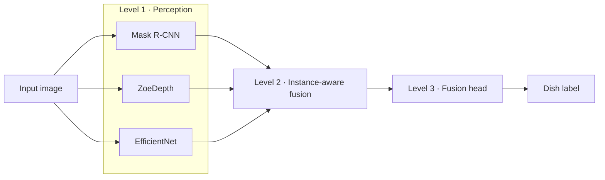

# Instance-Aware Food Recognition

This project recognizes each dish in a food photo separately, rather than labeling the whole image. For each detected dish it combines three signals — its mask, depth, and appearance — rather than appearance alone. Evaluated on a 25-class subset of Food-101, it runs in three levels — perception, fusion, and prediction:



Course project for CMP612 Neural Networks and Deep Learning, Cairo University. The paper is in `paper/`.

## Pipeline

**Level 1 — Perception.** Three pretrained models run on the image: Mask R-CNN segments each dish into its own mask, ZoeDepth estimates depth, and EfficientNet extracts appearance features.

**Level 2 — Instance-aware fusion.** For each detected dish, its mask, depth, and appearance are cropped to the dish and resized to a common grid, plus a few summary depth statistics — forming aligned per-instance tensors.

**Level 3 — Fusion head.** A small CNN encodes the mask and depth into FiLM parameters that scale and shift the appearance features; the modulated features are pooled over the mask, combined with the depth statistics, and an MLP predicts the dish class.

## Structure

```
food_vision_playground/scripts/
  lvl1/   perception
  lvl2/   instance-aware fusion block
  lvl3/   fusion head
  lvl4/   calorie estimation
clip_finetune/        CLIP specialist (hybrid pipeline)
dataset_collection/   data-collection notebooks
paper/                paper PDF
```

## What's trained

Only the Level 3 fusion head is trained, on the Food-101 subset. Level 1 perception is pretrained and frozen, and Level 2 has no learned parameters.

## Running it

Running the pipeline on an image saves each dish's mask, depth, and top-5 prediction under `runs/<image>/`:

```bash
python -m scripts.run_pipeline --image data/pizzas.avif --pipeline_mode fusion_head --fusion_ckpt fusion_head_k25.pt
```

Trained checkpoints aren't committed to the repo, so `fusion_head_k25.pt` won't be there after a clone. Produce it by training the fusion head (`scripts/train_fusion_food101.py`), then pass its path to `--fusion_ckpt`.

## Results

The fusion head reaches 70.0% top-1 accuracy on the Food-101 25-class subset.

## Extensions

### Automated dataset collection

An automated DINO+SAM pipeline (`dataset_collection/`) builds instance-labeled data for cuisines that standard benchmarks miss — for example, a small set of Egyptian dishes — with little manual labeling.

### Hybrid CLIP pipeline

The `hybrid_clip` mode swaps the trained fusion head for CLIP, classifying each detected dish from its image region rather than from the fused per-dish features (mask, depth, and appearance). It runs two classifiers: a general head matching the dish against Food-101 prompts, and a specialist linear probe (`clip_finetune/`) fine-tuned on the custom Egyptian dishes. The general prediction is returned by default, unless the specialist's confidence clears a threshold, in which case the specialist wins. It serves both as a baseline for the fusion head and as a generalist-plus-specialist route for under-represented classes.

### Calorie estimation

A Level 4 stub `lvl4/` computes a rough calorie proxy from each dish's volume — mask area times depth — and a small density/calorie table. The volume is uncalibrated, so real calorie estimation stays future work.

Licensed under MIT.

## Contributors

| [<br/>Fatema Kotb](https://github.com/FatemaKotb) | [<br/>Maryam Mohamed](https://github.com/maryammmabdelrahman-eng) |
|:-:|:-:|