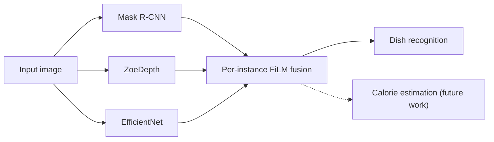

# Instance-Aware Food Recognition

A pipeline that recognizes each dish in a photo separately, rather than labeling the whole image. It combines three per-image models — dish outlines (Mask R-CNN), depth (ZoeDepth), and appearance features (EfficientNet) — and fuses them per dish to make a prediction.

Depth and shape are groundwork for the intended next step — estimating each dish's volume and calories — which is left as future work.



Course project for CMP612 Neural Networks and Deep Learning, Cairo University. The paper is in `paper/` and the slides in `presentation/`.

## Structure

```
food_vision_playground/    main pipeline (single-image inference + Food-101 evaluation)
  scripts/lvl1/            perception: Mask R-CNN, ZoeDepth, EfficientNet
  scripts/lvl2/            instance-aware FiLM fusion block
  scripts/lvl3/            prediction heads: fusion, hybrid CLIP, pretrained CLIP
  scripts/lvl4/            rule-based calorie prototype (stub)
  food101_cache_k2/, _k25/ cached per-instance tensors for training/eval
  data/                    demo images
clip_finetune/             CLIP linear-probe specialist for Egyptian dishes (src + Kaggle notebook)
dataset_collection/        DINO+SAM annotation and web-collection notebooks
paper/                     paper PDF
```

## Running it

The project centers on two datasets — a 25-class subset of Food-101 and a small custom set of Egyptian dishes — and two recognition pipelines that can run on either: a CLIP baseline and the instance-aware fusion model this project contributes. Both pipelines share the same perception front-end — Mask R-CNN for instances, ZoeDepth for depth, EfficientNet for features — and differ only in how they classify each detected dish. Each subproject has its own `requirements.txt`, and the pretrained models download their weights on first run; a GPU is recommended, though the per-image pipeline also runs on CPU.

Running the pipeline on an image segments the dishes, estimates depth, and prints the top-5 prediction for each detected instance, saving the masks, depth map, and overlays under `runs/<image>/`. The pipeline is chosen with `--pipeline_mode`.

The CLIP baseline classifies each dish with a general Food-101 CLIP head, falling back to a fine-tuned Egyptian specialist when the general head is unsure:

```bash
python -m scripts.run_pipeline --image data/pizzas.avif --pipeline_mode hybrid_clip
```

The fusion pipeline instead uses the trained instance-aware head, which modulates each dish's ROI appearance features by its mask-and-depth geometry:

```bash
python -m scripts.run_pipeline --image data/pizzas.avif --pipeline_mode fusion_head --fusion_ckpt fusion_head_k25.pt
```

The two models are trained separately. The fusion head is trained in two steps: the perception stage is run once over the dataset and its per-instance tensors are cached to disk, then the lightweight head is trained on that cache — so the slow models run once rather than on every epoch, and checkpoints are chosen by validation top-1 accuracy. The Egyptian specialist is trained from `clip_finetune/` as a CLIP linear probe (Kaggle notebook or `src/`) and plugs into the baseline above.

Level 4 (calorie estimation) is a rule-based prototype — a volume proxy from mask area times median depth, scaled by a small food-density and kcal lookup — and is not quantitatively evaluated.

## Results

Top-1 accuracy on the Food-101 25-class subset:

| Method | Top-1 |
|---|---|
| Pretrained CLIP | 71.20 |
| Instance-aware fusion (ours) | 70.00 |

The underrepresented Egyptian 5-dish benchmark is shown qualitatively, as per-instance predictions on example dishes; a full quantitative comparison on it was not finalized.

Licensed under MIT.

## Contributors

| [<br/>Fatema Kotb](https://github.com/FatemaKotb) | [<br/>Maryam Mohamed](https://github.com/maryammmabdelrahman-eng) |
|:-:|:-:|