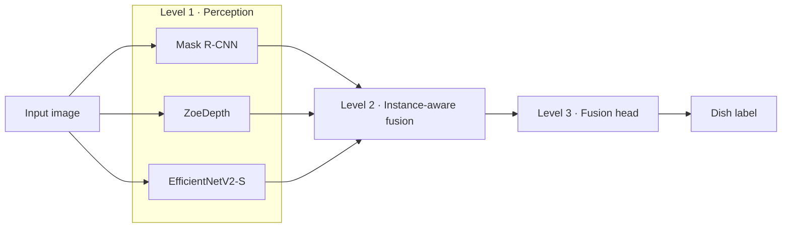

# Instance-Aware Food Recognition

This project recognizes each dish in a food photo separately, rather than labeling the whole image. For each detected dish it combines three signals — its mask, depth, and appearance — rather than appearance alone. Evaluated on a 25-class subset of Food-101, it runs in three levels — perception, fusion, and prediction:



Course project for CMP612 Neural Networks and Deep Learning, Cairo University. The paper is in `paper/`.

## Pipeline

**Level 1 — Perception.** Three pretrained models run on the image: Mask R-CNN (COCO-pretrained, from TorchVision) segments the image into instance masks, ZoeDepth estimates depth, and EfficientNetV2-S extracts appearance features. Masks covering less than 20% of the image are dropped, so small dishes may be missed.

**Level 2 — Instance-aware fusion.** For each detected dish, its mask, depth, and appearance are cropped to the dish and resized to a common 7×7 grid, plus 8 summary depth statistics — forming aligned per-instance tensors.

**Level 3 — Fusion head.** A small CNN encodes the mask and depth into FiLM parameters that scale and shift the appearance features; the modulated features are pooled over the mask, combined with the depth statistics, and an MLP predicts the dish class.

## Structure

```
food_vision_playground/scripts/
  lvl1/   perception (Mask R-CNN, ZoeDepth, EfficientNet)
  lvl2/   instance-aware fusion block, fusion head model, and the fusion stub used by hybrid mode
  lvl3/   prediction heads (fusion-head wrapper, pretrained CLIP, Egyptian CLIP probe, hybrid)
  lvl4/   calorie estimation stub
clip_finetune/        CLIP specialist (hybrid pipeline)
dataset_collection/   data-collection notebooks
paper/                paper PDF
```

## What's trained

Only the fusion head is trained, on the Food-101 subset. Level 1 perception is pretrained and frozen, and the Level 2 fusion block has no learned parameters.

## Running it

Commands run from `food_vision_playground/`. Running the pipeline on an image saves, under `runs/<image>/`, the input image, each dish's masked image and depth map (`.png` and `.npy`), and an `instances.json` with each dish's top-1 class and confidence. The top-5 predictions are printed to the console.

```bash
cd food_vision_playground
python -m scripts.run_pipeline --image data/pizzas.avif --pipeline_mode fusion_head --fusion_ckpt fusion_head_k25.pt
```

`--pipeline_mode` defaults to `hybrid_clip`, so pass `fusion_head` explicitly to use the fusion head.

Trained checkpoints aren't committed to the repo, so `fusion_head_k25.pt` won't be there after a clone. To produce it, first cache per-instance features with `scripts/cache_food101_instances.py`, then train the fusion head on that cache:

```bash
python -m scripts.train_fusion_food101 --cache_dir food101_cache_k25 --out_ckpt fusion_head_k25.pt
```

Without `--out_ckpt`, the checkpoint is saved as `fusion_head_subset.pt`.

## Results

The fusion head reaches 70.0% top-1 accuracy on the Food-101 25-class subset.

## Extensions

### Automated dataset collection

An automated DINO+SAM pipeline (`dataset_collection/`) builds instance-labeled data for cuisines that standard benchmarks miss — for example, a small set of Egyptian dishes — with little manual labeling.

### Hybrid CLIP pipeline

The `hybrid_clip` mode (the default) swaps the trained fusion head for CLIP, classifying each detected dish from its image region rather than from the fused per-dish features (mask, depth, and appearance). It runs two classifiers: a general zero-shot head matching the dish against Food-101 prompts, and a specialist linear probe (`clip_finetune/`) — a linear layer trained on frozen CLIP features — for 5 Egyptian dishes. The general prediction is returned by default, unless the specialist's confidence reaches 0.60, in which case the specialist wins. It serves both as a baseline for the fusion head and as a generalist-plus-specialist route for under-represented classes. This mode needs the specialist checkpoint `egypt_clip_linear.pt`, which is also not committed; train it with `clip_finetune/`.

### Calorie estimation

A Level 4 stub `lvl4/` computes a rough calorie proxy from each dish's volume — mask pixel count times median depth — and a density/calorie table covering only four foods (pizza, salad, burger, rice). The volume is uncalibrated and the result isn't saved or printed, so real calorie estimation stays future work.

Licensed under MIT.

## Contributors

| [<br/>Fatema Kotb](https://github.com/FatemaKotb) | [<br/>Maryam Mohamed](https://github.com/maryammmabdelrahman-eng) |
|:-:|:-:|
